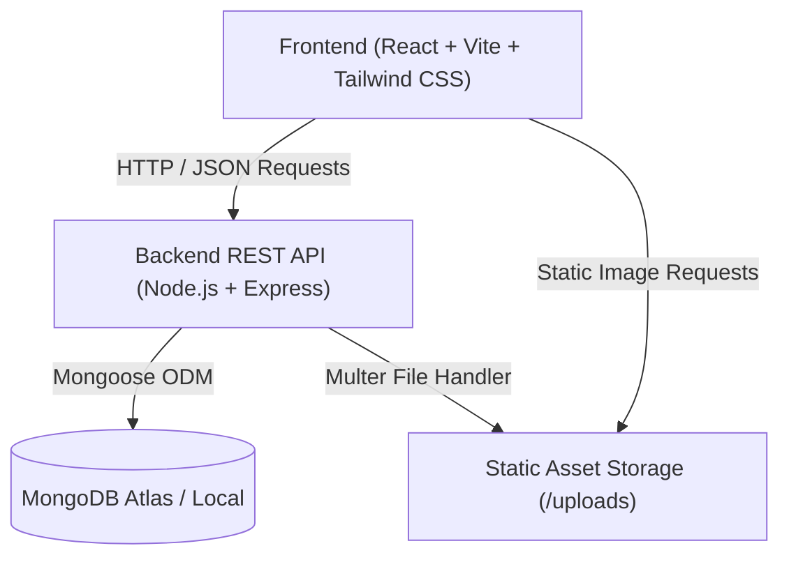

<div align="center">

# 🌱 AgriNet

### Modern Agricultural Marketplace & Network Platform

[](https://react.dev/)
[](https://vitejs.dev/)
[](https://tailwindcss.com/)
[](https://nodejs.org/)
[](https://expressjs.com/)
[](https://www.mongodb.com/)
[](LICENSE)

<p align="center">
  A full-stack agricultural platform designed to bridge the gap between farmers, producers, and consumers. AgriNet eliminates intermediaries by offering a direct, transparent marketplace with real-time product inventory, role-based dashboards, and streamlined order checkout.
</p>

</div>

---

## 📌 Table of Contents

- [Features](#-features)
- [Architecture & Tech Stack](#-architecture--tech-stack)
- [Folder Structure](#-folder-structure)
- [Getting Started](#-getting-started)
  - [Prerequisites](#prerequisites)
  - [Installation](#installation)
  - [Environment Setup](#environment-setup)
- [Running the Application](#-running-the-application)
- [API Reference](#-api-reference)
- [Security & Best Practices](#-security--best-practices)
- [Contributing](#-contributing)
- [License](#-license)

---

## ✨ Features

### 🛒 Marketplace & Shopping Experience
- **Real-time Product Catalog**: Dynamic product listings fetched from MongoDB with category filtering, price sliders, and instant search.
- **Interactive Cart System**: Context-driven shopping cart supporting quantity adjustments, item selection, and total price calculation.
- **Streamlined Checkout**: Step-by-step order placement flow with customer address capture and masked payment simulation.

### 👥 Role-Based Portals & Dashboards
- **Buyer Dashboard**: View profile details, order history, and update personal account settings.
- **Seller Dashboard**: Comprehensive portal for farmers and vendors to list new produce, manage inventory quantities, and upload product images.
- **Admin Management Console**: Dedicated administrator panel to oversee registered buyers, sellers, and system transaction records.

### 🎨 Modern UI & UX
- Responsive design tailored for mobile, tablet, and desktop screens.
- Smooth transitions and scroll animations powered by Framer Motion & AOS.
- Dark mode toggle and interactive navigation menus.

---

## 🛠 Architecture & Tech Stack



| Area | Technologies |
| :--- | :--- |
| **Frontend** | React 18, Vite, Tailwind CSS, React Router v7, Framer Motion, Axios, Lucide Icons |
| **Backend** | Node.js, Express.js, Multer, CORS, dotenv, Body-Parser |
| **Database** | MongoDB with Mongoose ODM |
| **Authentication** | JSON Web Tokens (JWT), Bcrypt password hashing |

---

## 📂 Folder Structure

```text
AgriNet/
├── client/                     # Frontend Application
│   ├── public/                 # Static public files & favicon
│   ├── src/
│   │   ├── assets/             # Images, banners, and logos
│   │   ├── components/         # Reusable UI components (Navbar, Footer, Product, etc.)
│   │   ├── config/             # Centralized API configuration
│   │   ├── Home/               # Landing page sections & sliders
│   │   ├── Pages/              # Page views (Market, Cart, Login, Signup, Dashboards)
│   │   ├── services/           # API interaction helpers
│   │   ├── App.jsx             # Main router & layout entry
│   │   ├── main.jsx            # React root mount
│   │   └── index.css           # Tailwind CSS directives & global styling
│   ├── .env.example            # Client environment template
│   ├── .gitignore              # Client ignore rules
│   ├── package.json            # Client dependencies & scripts
│   └── vite.config.js          # Vite build & development proxy config
│
├── server/                     # Backend REST API
│   ├── config/                 # Database connection (db.js)
│   ├── controllers/            # Controller logic (productController, userController)
│   ├── middleware/             # JWT auth & error handling middlewares
│   ├── models/                 # Mongoose schemas (User, Product, Cart, Payment)
│   ├── routes/                 # Express route definitions
│   ├── uploads/                # Uploaded product image storage
│   ├── .env.example            # Server environment template
│   ├── .gitignore              # Server ignore rules
│   ├── package.json            # Server dependencies & scripts
│   └── server.js               # Express application entry point
│
├── .gitignore                  # Repository-level ignore rules
└── README.md                   # Project documentation
```

---

## 🚀 Getting Started

### Prerequisites

Make sure you have the following installed on your machine:
- [Node.js](https://nodejs.org/) (version `v18.0.0` or higher recommended)
- [npm](https://www.npmjs.com/) (version `9.0.0` or higher)
- A [MongoDB Atlas](https://www.mongodb.com/atlas) cluster or local MongoDB instance

---

### Installation

1. **Clone the repository:**
   ```bash
   git clone https://github.com/Isura-udith/AgriNet.git
   cd AgriNet
   ```

2. **Install Server Dependencies:**
   ```bash
   cd server
   npm install
   ```

3. **Install Client Dependencies:**
   ```bash
   cd ../client
   npm install
   ```

---

### Environment Setup

#### 1. Backend Configuration (`server/.env`)
Navigate to the `server/` directory and create a `.env` file based on `.env.example`:

```bash
cd server
cp .env.example .env
```

Edit `.env` with your actual settings:
```env
PORT=5000
MONGO_URI=mongodb+srv://<username>:<password>@cluster0.mongodb.net/AgriNet?retryWrites=true&w=majority
NODE_ENV=development
JWT_SECRET=your_super_secret_jwt_key
```

#### 2. Frontend Configuration (`client/.env`)
Navigate to the `client/` directory and create a `.env` file (optional, defaults to `http://localhost:5000`):

```bash
cd ../client
cp .env.example .env
```

```env
VITE_API_URL=http://localhost:5000
VITE_ADMIN_ACCESS_CODE=admin
```

---

## 💻 Running the Application

Both the client and the server run independently:

### 1. Start Backend Server
```bash
cd server
npm run dev
```
> The API server will start at: `http://localhost:5000`

### 2. Start Frontend Application
In a new terminal window:
```bash
cd client
npm run dev
```
> The Vite development server will start at: `http://localhost:5173`

---

## 📡 API Reference

### 🔐 Authentication & Users (`/api/users`)
| Method | Endpoint | Description | Auth Required |
| :--- | :--- | :--- | :---: |
| `POST` | `/api/users/register` | Register new buyer or seller | No |
| `POST` | `/api/users/login` | User login & token generation | No |
| `GET` | `/api/users/:id` | Get user details by ID | Yes |
| `GET` | `/api/users?role=:role` | Filter users by role (`buyer`/`seller`) | No |
| `PUT` | `/api/users/:id` | Update user profile data | No |
| `DELETE`| `/api/users/:id` | Remove user record | No |

### 🌾 Products (`/api/products`)
| Method | Endpoint | Description | Auth Required |
| :--- | :--- | :--- | :---: |
| `GET` | `/api/products` | Fetch all listed products | No |
| `POST` | `/api/products` | Create product with multipart image upload | No |

### 🛍 Cart & Payments (`/api/cart`, `/api/payments`)
| Method | Endpoint | Description |
| :--- | :--- | :--- |
| `GET` | `/api/cart` | Retrieve cart items |
| `POST` | `/api/cart` | Add item to cart |
| `DELETE`| `/api/cart/:id` | Remove item from cart |
| `POST` | `/api/payments` | Process payment (masked card storage) |

---

## 🔒 Security & Best Practices

- **Zero Credential Leaks**: Credentials, secrets, and database strings are fully abstracted into ignored `.env` files.
- **Cardholder Data Protection**: Payment card numbers are masked (`****-****-****-1234`) and CVV codes are never stored.
- **Protected Password Hashes**: Passwords are cryptographically hashed using **Bcrypt** before database persistence and excluded from user query payloads.

---

## 🤝 Contributing

Contributions are welcome! Please follow these steps:

1. Fork the Project
2. Create your Feature Branch (`git checkout -b feature/AmazingFeature`)
3. Commit your Changes (`git commit -m 'Add some AmazingFeature'`)
4. Push to the Branch (`git push origin feature/AmazingFeature`)
5. Open a Pull Request

---

## 📄 License

Distributed under the MIT License. See `LICENSE` for more information.

---

<div align="center">
  <sub>Built with ❤️ for the agricultural community.</sub>
</div>
